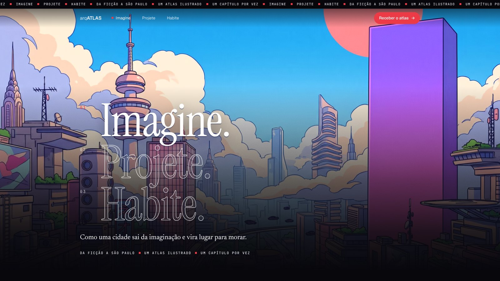
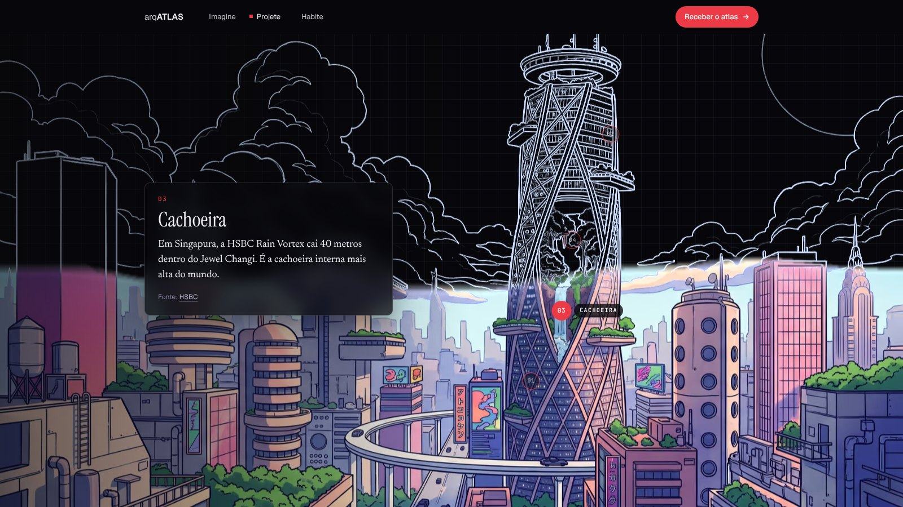
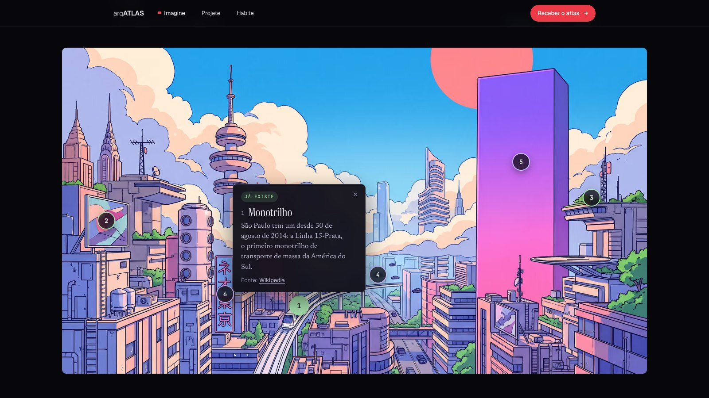

<div align="center">

<a href="https://arqatlas-theta.vercel.app"></a>

# arqATLAS

**Imagine. Projete. Habite.**

<a href="https://arqatlas-theta.vercel.app"></a>


</div>

<br>

Um atlas ilustrado de uma página sobre **como uma cidade sai da imaginação e vira lugar para morar**. O título é o caminho do site, em três atos:

- **Imagine.** A megacidade que o cinema sonhou para 2019, e o que dela já chegou: seis pontos dizem o que já existe e o que ainda é ficção.
- **Projete.** Uma torre imaginada se desenha em linhas de luz conforme a página rola e depois ganha cor, de baixo para cima. Cada parte dela já existe em algum prédio real: a malha em diagonal da Hearst Tower, a torção da Shanghai Tower, a cachoeira do Jewel Changi e a floresta do Bosco Verticale.
- **Habite.** São Paulo do pôr do sol à noite, com o Copan, o MASP e a Ponte Estaiada: os prédios mais futuristas da cidade foram desenhados há décadas, e o que fez deles futuro foi a cidade que passou a viver neles.

Todo número tem fonte, ao lado dele e no rodapé. As quatro ilustrações foram geradas com IA e são a única arte do site.

<p align="center">
  
  
</p>
<p align="center"><sub>A Torre se desenha com a rolagem; na Megacidade, cada ponto diz o que da ficção já chegou.</sub></p>

## Rodar

```bash
npm install
npm run dev        # http://localhost:3000
```

| Comando | O que faz |
|---|---|
| `npm run dev` | servidor de desenvolvimento |
| `npm run build` | checagem de tipos + build de produção em `.next/` |
| `npm start` | serve o build de produção (http://localhost:3000) |
| `npm run lint` | ESLint com as regras do Next.js |
| `npm run typecheck` | checagem de tipos |
| `npm test` | testes de unidade (vitest): textos, números e fontes do roteiro, pontos da Megacidade, matemática das cenas fixadas e rota do formulário |
| `npm run e2e` | testes no Chrome (faz o build e sobe o servidor sozinho): console sem erros, a frase que acende, os pontos da Megacidade, a Torre que se desenha, o pôr do sol que vira noite, o ato da vez no menu, crédito do rodapé, formulário e movimento reduzido; no tamanho de um celular, recorte vertical da capa, saída para o preto, mapa em lista e a Torre na tela inteira com os cartões subindo por cima, com o traço na resolução da tela, sem rolar para os lados |
| `npm run shots` | refaz as imagens deste README em `docs/` (com `npm start` rodando) |
| `python3 scripts/traco.py` | refaz os campos de tempo do desenho da Torre a partir da ilustração (precisa de numpy e Pillow; o uso está no topo do arquivo) |

## Onde mexer

| Arquivo | Conteúdo |
|---|---|
| `src/content/copy.pt-BR.ts` | **todos os textos** do site: abertura, a frase, os pontos da Megacidade, as notas da Torre, os cartões de São Paulo, perguntas, convite e formulário, com as fontes |
| `src/content/brand.ts` | nome do projeto e crédito do rodapé: nome, logo, link para miguelrsant.com.br, redes e repositório |
| `src/styles/tokens.css` | o design system: paleta, fontes, espaçamentos, raios, curvas e sombras |
| `src/assets/` | as quatro ilustrações (Megacidade, Torre-ícone, São Paulo ao pôr do sol e à noite), os recortes verticais para telas em pé (`*-retrato.jpg`), os recortes de cada prédio e, em `projete/`, os campos de tempo do desenho da Torre |
| `src/components/` | uma seção por componente, cada uma com o seu CSS Module; `Cena.module.css` e `useCena.ts` são as duas cenas fixadas (Projete e Habite), e `TallSource.tsx` troca a ilustração larga pelo recorte vertical em telas em pé |
| `src/lib/cena.ts` | a matemática das cenas fixadas: progresso, cartão da vez, fases do desenho da Torre e a noite do Habite |
| `src/lib/traco-gl.ts` | o sombreador WebGL do desenho da Torre, sem biblioteca |
| `src/lib/daynight.ts` | a curva da capa e as palavras acesas da frase |
| `scripts/traco.py` | gera os campos de tempo do desenho (por onde o traço anda e por onde a cor sobe) |
| `src/app/api/inscricao/route.ts` | recebe o e-mail do formulário e repassa para o serviço configurado |
| `public/brand/` | logo da marca (M preto e M claro, fundo transparente) e ícones PNG (Android) |
| `src/app/icon.svg` / `favicon.ico` / `apple-icon.png` | ícones do site (M claro sobre azul-noite, detalhes em vermelho) |
| `src/app/opengraph-image.jpg` | imagem de compartilhamento (WhatsApp, LinkedIn, X) |

Os pontos da Megacidade ficam em `copy.mapa.pontos`, e as marcas da Torre e de São Paulo no campo `marca` de cada nota e de cada prédio, com `x` e `y` em porcentagem da ilustração (na imagem larga e no recorte em pé). Ao mudar um texto ou número, rode `npm test`: os testes conferem os números das notas, se toda fonte é `https` e se os pontos caem dentro da imagem.

Para fotos e revisão, `/?quadro` deixa cada cena parada no seu momento mais representativo (`QUADRO` em `src/lib/cena.ts`).

## Formulário "Receber o atlas"

- **Sem configuração, roda em modo demonstração:** valida o e-mail, agradece e avisa que o endereço não foi guardado.
- **Para guardar os e-mails**, defina `INSCRICAO_WEBHOOK_URL` (na Vercel, em Settings → Environment Variables). A rota `POST /api/inscricao` envia `{ "email", "origem": "arqatlas", "data" }` em JSON para essa URL: um webhook do Zapier, Make ou n8n, ou o endpoint do seu serviço de newsletter.
- Um campo escondido (`empresa`) segura robôs, o e-mail é normalizado (minúsculas, sem espaços nas pontas) e o envio tem limite de 8 s. Se o serviço falhar, o leitor vê um aviso para tentar de novo.

## Como funciona (resumo)

- **A Torre se desenha.** Um sombreador WebGL pequeno, sem biblioteca, tira o traço da própria ilustração: um pixel é nanquim quando é mais escuro que o anel de vizinhos em volta dele. Cada pixel tem um tempo, calculado uma vez por `scripts/traco.py` (a distância pelas linhas a partir da base, igualada para o desenho andar num ritmo só), e aparece quando o progresso da cena passa dele; depois a cor sobe por um segundo campo, mais suave, que só cresce de baixo para cima e não deixa pedaço de céu escuro para trás. Os dois campos pesam cerca de 38 KB no computador e 17 KB no celular. Até o sombreador ficar pronto, ou sem WebGL, a ilustração colorida fica no palco.
- **Cenas fixadas.** Projete e Habite ficam presas na tela (`position: sticky`) enquanto os cartões passam por cima do palco. Em telas em pé a Torre continua assim, com só a marca da vez acesa; no Habite o palco fica no topo e os cartões passam embaixo dele, para não cobrir os prédios. A cada quadro (`requestAnimationFrame`), `useCena` mede a rolagem, desenha a Torre ou escurece São Paulo (variável `--noite`) e acende o cartão e a marca da vez. A rolagem é sempre de quem lê: nada pula de seção em seção.
- **A frase que acende.** Cada palavra é um `span`, e `litWords` decide quantas já estão acesas pela posição do bloco na tela; o fim da frase acende em itálico rosa. Sem JavaScript, a frase fica inteira acesa.
- **O que a ficção acertou.** Seis pontos sobre a Megacidade: três com o selo "Já existe" (verde) e três com "Ainda é ficção" (lilás). Eles entram em sequência quando a cena chega na tela. O cartão abre para o lado que cabe na imagem e fecha com Esc ou com um clique fora. No celular em pé, nada rola para os lados: a cena fica parada no topo enquanto os pontos passam por baixo dela, em lista; o ponto da vez acende e a cena se aproxima dele.
- **Menu.** O ato da vez (Imagine, Projete ou Habite) acende no menu, com `aria-current`.
- **Servidor e navegador.** Só oito componentes rodam no navegador (capa, menu, frase, mapa, Projete, Habite, título do convite e formulário). O resto é renderizado no servidor, e a página sai estática no build.
- **Barra de rolagem.** No computador, uma pílula fina do rosa do destaque ao lilás da ficção, num trilho da cor da noite (`globals.css`). Chrome, Edge e Safari aceitam o degradê; o Firefox usa a mesma cor, lisa. No celular fica a barra do sistema.
- **Acessibilidade.** Cada ilustração tem texto alternativo e todo texto existe no HTML desde o primeiro byte. Quem pede menos movimento (`prefers-reduced-motion`) vê as cenas sem fixar: a Torre colorida com o desenho técnico parado logo depois, e São Paulo ao pôr do sol e depois à noite.

## Desempenho

- **Imagens:** `next/image` entrega AVIF ou WebP no tamanho da tela, com um placeholder borrado embutido no HTML. O `sizes` de cada ilustração segue a largura com que ela aparece de fato (na capa ela cobre a tela pela altura), então o navegador não estica uma imagem pequena. A capa vem com prioridade alta e sem preload, para o celular não baixar também a versão larga; o resto carrega perto da tela.
- **Celular:** em telas em pé, cada ilustração usa um recorte vertical 3:4 (`<picture>` com `TallSource`). Os recortes foram ampliados 2× com IA (Real-ESRGAN) e ganharam de volta o grão da arte; um celular comum recebe a capa com ~1.900 px de largura (~190 KB em AVIF). A Torre baixa perto da cena, e o sombreador usa a mesma imagem do pôster (qualidade 85, para a compressão não virar ruído no traço) e desenha até 3× a tela, então o traço sai nítido também no iPhone.
- **Fontes:** Instrument Serif, Newsreader, Geist e JetBrains Mono são servidas pelo próprio site (`next/font`), sem pedido ao Google e sem salto de layout.
- **JavaScript:** o código do site soma ~20 KB gzip, com o sombreador e os textos que os componentes do navegador usam; o resto (~130 KB) é o runtime do React e do Next.js. Os efeitos de scroll não usam biblioteca de animação, e o desenho da Torre não usa biblioteca 3D.
- **Build:** Next.js 16 com Turbopack e Cache Components. A página é pré-renderizada, e só `/api/inscricao` roda sob demanda.

## Publicar (Vercel)

Importe o repositório na Vercel com o preset **Next.js** (sem configuração extra). Cada push na `main` publica em produção. Para o formulário guardar os e-mails, adicione `INSCRICAO_WEBHOOK_URL` em Environment Variables.

## Limitações conhecidas

- **O formulário está em modo demonstração** até `INSCRICAO_WEBHOOK_URL` ser configurada: ainda não há lista nem envio de e-mails.
- **As ilustrações são geradas com IA.** A Megacidade e a Torre-ícone são imaginadas. Os prédios de São Paulo são reais, mas os desenhos não são fotos nem projetos: detalhes como janelas e número de andares não batem com os prédios.
- **O desenho da Torre precisa de WebGL.** Sem ele, ou com movimento reduzido, a Torre aparece colorida e parada, com o desenho técnico ao lado.
- **Só em português** por enquanto; os textos já ficam separados em `copy.pt-BR.ts` para outra língua.
- Os testes no navegador usam o Google Chrome instalado, com o WebGL no SwiftShader. Em CI, aponte `CHROMIUM_PATH` para outro Chromium.

---

<div align="center">

Feito por **Miguel Angelo** · [miguelrsant.com.br](https://miguelrsant.com.br) · [LinkedIn](https://www.linkedin.com/in/miguelrsant) · [GitHub](https://github.com/miguelrsant)

</div>
