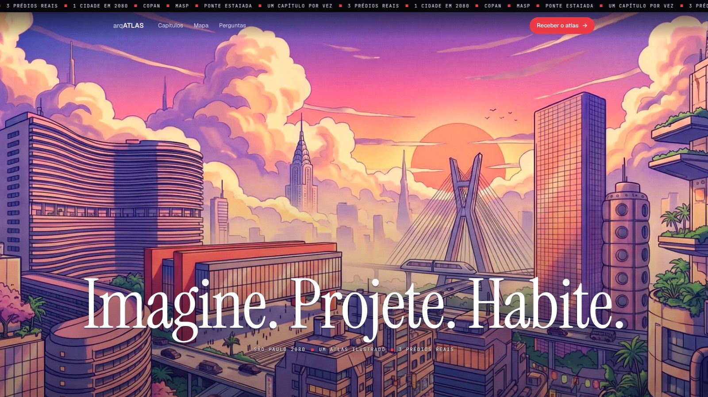
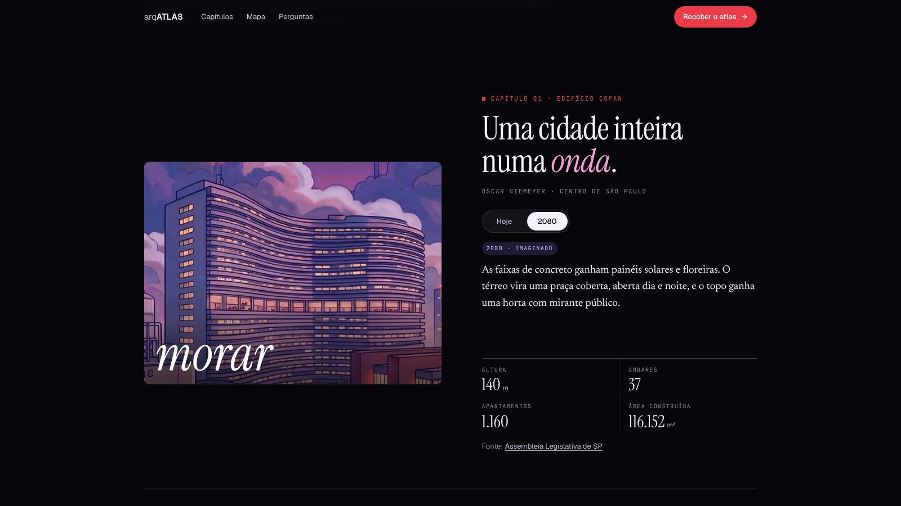
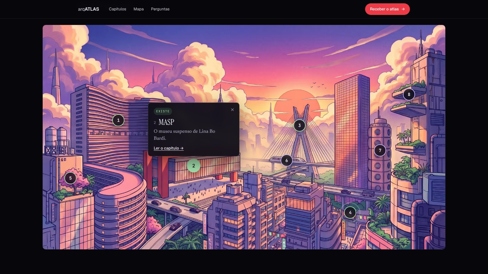

<div align="center">

<a href="https://arqatlas-theta.vercel.app"></a>

# arqATLAS

**Imagine. Projete. Habite.**

<a href="https://arqatlas-theta.vercel.app"></a>


</div>

<br>

Um atlas ilustrado de uma página que **explica três prédios reais de São Paulo como são hoje e imagina cada um em 2080**: o Copan (morar), o MASP (encontrar) e a Ponte Estaiada (atravessar). A capa começa ao pôr do sol e escurece até a noite conforme a página rola. Em cada capítulo, um botão troca o prédio real pelo imaginado, e um mapa da cena separa, ponto por ponto, o que existe do que é ficção.

Os números das fichas (altura, andares, vão livre, estais) vêm de fontes públicas, citadas em cada capítulo e no rodapé. As duas ilustrações da cidade foram geradas com IA e são a única arte do site: os recortes de cada prédio saem delas.

<p align="center">
  
  
</p>
<p align="center"><sub>Hoje e 2080: o botão do capítulo troca o real pelo imaginado, e o mapa separa um do outro.</sub></p>

## Rodar

```bash
npm install
npm run dev        # http://localhost:3000
```

| Comando | O que faz |
|---|---|
| `npm run dev` | servidor de desenvolvimento |
| `npm run build` | checagem de tipos + build de produção em `.next/` |
| `npm start` | serve o build de produção (http://localhost:3000) |
| `npm run lint` | ESLint com as regras do Next.js |
| `npm run typecheck` | checagem de tipos |
| `npm test` | testes de unidade (vitest): textos e números do roteiro, pontos do mapa, curva do pôr do sol à noite e rota do formulário |
| `npm run e2e` | testes no Chrome (faz o build e sobe o servidor sozinho): console sem erros, crédito do rodapé, botão Hoje/2080, mapa e formulário |
| `npm run shots` | refaz as imagens deste README em `docs/` (com `npm start` rodando) |

## Onde mexer

| Arquivo | Conteúdo |
|---|---|
| `src/content/copy.pt-BR.ts` | **todos os textos** do site: capa, manifesto, capítulos (texto de hoje, texto de 2080, ficha e fontes), pontos do mapa, perguntas e formulário |
| `src/content/brand.ts` | nome do projeto e crédito do rodapé: nome, logo, link para miguelrsant.com.br, redes e repositório |
| `src/styles/tokens.css` | o design system: paleta, fontes, espaçamentos, raios, curvas e sombras |
| `src/assets/` | as duas ilustrações (pôr do sol e noite) e os recortes de cada prédio |
| `src/components/` | uma seção por componente, cada uma com o seu CSS Module |
| `src/lib/daynight.ts` | as curvas do scroll: pôr do sol → noite na capa e palavras acesas no manifesto |
| `src/app/api/inscricao/route.ts` | recebe o e-mail do formulário e repassa para o serviço configurado |
| `public/brand/` | logo da marca (M preto e M claro, fundo transparente) e ícones PNG (Android) |
| `src/app/icon.svg` / `favicon.ico` / `apple-icon.png` | ícones do site (M claro sobre azul-noite, detalhes em vermelho) |
| `src/app/opengraph-image.jpg` | imagem de compartilhamento (WhatsApp, LinkedIn, X) |

Os pontos do mapa ficam em `copy.mapa.pontos`, com `x` e `y` em porcentagem da ilustração. Ao mudar um texto ou número, rode `npm test`: os testes conferem se os números da ficha aparecem no texto, se toda fonte é `https`, se os pontos caem dentro da imagem e se os pontos dos prédios levam a capítulos que existem.

## Formulário "Receber o atlas"

- **Sem configuração, roda em modo demonstração:** valida o e-mail, agradece e avisa que o endereço não foi guardado.
- **Para guardar os e-mails**, defina `INSCRICAO_WEBHOOK_URL` (na Vercel, em Settings → Environment Variables). A rota `POST /api/inscricao` envia `{ "email", "origem": "arqatlas", "data" }` em JSON para essa URL: um webhook do Zapier, Make ou n8n, ou o endpoint do seu serviço de newsletter.
- Um campo escondido (`empresa`) segura robôs, o e-mail é normalizado (minúsculas, sem espaços nas pontas) e o envio tem limite de 8 s. Se o serviço falhar, o leitor vê um aviso para tentar de novo.

## Como funciona (resumo)

- **Pôr do sol → noite no scroll.** As duas ilustrações ficam empilhadas. A cada quadro (`requestAnimationFrame`), a capa calcula quanto já rolou e grava variáveis CSS (`--night`, `--glow`, `--fade`); o CSS faz a transição. Nada passa pelo estado do React, então rolar não causa re-render.
- **Manifesto que acende.** Cada palavra é um `span`, e `litWords` decide quantas já estão acesas pela posição do bloco na tela.
- **Hoje / 2080.** Cada capítulo tem os dois recortes e os dois textos no mesmo lugar. O botão (`aria-pressed`) troca qual aparece; o texto escondido fica `inert` e fora da leitura de tela.
- **Mapa da cena.** Oito pontos sobre a ilustração: cinco com o selo "Existe" (verde) e três com "2080" (lilás). O cartão abre para o lado que cabe na imagem, fecha com Esc ou com um clique fora, e os pontos dos prédios levam ao capítulo. No celular, o cartão vai para baixo da imagem.
- **Servidor e navegador.** Só seis componentes rodam no navegador (capa, menu, manifesto, capítulo, mapa e formulário). O resto é renderizado no servidor, e a página sai estática no build.
- **Acessibilidade.** Cada ilustração tem texto alternativo, a faixa que corre no topo tem uma versão parada para leitores de tela, e quem pede menos movimento (`prefers-reduced-motion`) vê a capa sem animação.

## Desempenho

- **Imagens:** `next/image` entrega AVIF ou WebP no tamanho da tela, com um placeholder borrado embutido no HTML. Só a ilustração da capa é pré-carregada; o resto carrega perto da tela.
- **Fontes:** Instrument Serif, Newsreader, Geist e JetBrains Mono são servidas pelo próprio site (`next/font`), sem pedido ao Google e sem salto de layout.
- **JavaScript:** o código do site soma ~14 KB gzip; o resto (~170 KB) é o runtime do React e do Next.js. Os efeitos de scroll não usam biblioteca de animação.
- **Build:** Next.js 16 com Turbopack e Cache Components. A página é pré-renderizada, e só `/api/inscricao` roda sob demanda.

## Publicar (Vercel)

Importe o repositório na Vercel com o preset **Next.js** (sem configuração extra). Cada push na `main` publica em produção. Para o formulário guardar os e-mails, adicione `INSCRICAO_WEBHOOK_URL` em Environment Variables.

## Limitações conhecidas

- **O formulário está em modo demonstração** até `INSCRICAO_WEBHOOK_URL` ser configurada: ainda não há lista nem envio de e-mails.
- **As ilustrações são geradas com IA.** Os prédios são reais, mas os desenhos não são fotos nem projetos: detalhes como janelas e número de andares não batem com os prédios, e tudo que aparece em 2080 é ficção.
- **Três capítulos por enquanto** (Copan, MASP e Ponte Estaiada) e só em português; os textos já ficam separados em `copy.pt-BR.ts` para outra língua.
- Os testes no navegador usam o Google Chrome instalado. Em CI, aponte `CHROMIUM_PATH` para outro Chromium.

---

<div align="center">

Feito por **Miguel Angelo** · [miguelrsant.com.br](https://miguelrsant.com.br) · [LinkedIn](https://www.linkedin.com/in/miguelrsant) · [GitHub](https://github.com/miguelrsant)

</div>
